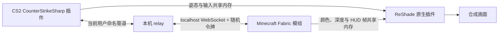

# 制作思路与架构

## 两个世界，各自运行

项目没有把整个 Minecraft 移植到 Source 2。Minecraft 与 CS2 仍然是独立进程：前者运行方块世界和模组，后者运行本地地图与插件。桥接层让两个进程共享玩家状态，再把 Minecraft 渲染结果嵌入 CS2 的最终画面。

## 控制消息与渲染数据分开

`relay/Program.cs` 将命名管道 `MC-CS-Bridge-v1` 中的逐行 JSON 转为本机 WebSocket 消息。Minecraft 的 `HostLink.java` 默认只监听回环地址的 25599 端口，并要求与 relay 一致的授权令牌。令牌应由使用者在本地生成，不进入版本库。

CS2 插件创建 4096 字节的 `Local\MC_CS_Bridge_Pose` 共享区，发布姿态、输入及状态。Minecraft 的 `FrameExporter.java` 通过另一块 `Local\MCPassthroughFrame` 共享区发布渲染帧。原生合成器读取帧并上传图像资源，避免在控制消息里传输整幅画面。

协议包含固定偏移、序列与尺寸信息。改动一端结构时必须同时核对另一端，不能只改某个字段的类型或大小；历史问题包括重叠字段写入和过期状态。

## 坐标与碰撞

核心比例是 40 个 CS 单位对应 1 个 MC 方块。坐标轴变换将 CS 的 Z 轴高度对应到 MC 的 Y 轴，并将 CS 的 Y 轴取反映射到 MC 的 Z 轴。垂直偏移的默认值是 96；部分代码接受每地图偏移，但 `WorldGeometry.cs` 的静态变换仍写死 96，因此变更偏移时需要核对整个链路。

`MapExport` 等离线工具从使用者自己的地图资源导出几何，`WorldGeometry.cs` 构建三角形空间树用于射线和表面采样。`SurfaceIndex`、`BlockColliders` 与 `BlockResync` 负责把碰撞或方块状态同步到相应世界。游戏资源与导出缓存不随源码分发。

## 画面合成

Minecraft 端将世界颜色、深度和独立 HUD 层导出。`native/compositor.cpp` 与 `shaders/MCPassthrough.fx` 负责对齐视角、深度遮挡和叠加。HUD 不应像三维方块一样被场景深度遮住。姿态预测和重投影用来缓解两个游戏帧率、采样时刻不一致造成的抖动。

## 玩法组件

`MinecraftBridge.cs` 管理生命周期、连接和主要事件；`MinecraftMovement.cs`、`AvatarCamera.cs` 管理移动及相机。`ActorInteractions.cs`、`JuvenileAi.cs`、`SquashDance.cs` 管理互动仪式、小 T 行为和动作。`ObsidianBlastShield.cs`、`TerrainLab.cs` 对接爆炸与地形实验。

这些玩法的实现不等同于全部完成验收，特别是追击障碍处理、附件跟随和镜头操作。

## 预切地形破坏

CS2 静态地图几何无法由本项目在运行时任意移除。实验方案是先离线切掉指定区域的物理和渲染几何，再用 MC 方块覆盖坑洞；爆炸清掉覆盖层后，露出预先存在的坑。物理切割与渲染切割是两条必须同步验证的处理链。

`MapPatchLab` 处理物理及 VPK 重打包，`MapCutRender` 处理渲染网格。跨区域凸包、跨边界三角形、未处理区域仍有限制。这是局部预处理方案，不是整个地图实时体素化。

## F8 回放动作

F8 本地模式不需要 MC 服务端发布机器人列表。原生插件识别已验证网格和着色器，把身体、武器和手套按共同根位置变换。颜色、深度、遮罩与附件必须保持一致，否则会出现原姿态黑影、悬浮附件或穿插。

生产路径使用离线生成的精确哈希着色器缓存；未知变体保持原状。不要把旧同步诊断采集重新挂回渲染回调，也不要在绘制回调里编译着色器。网格识别读取采用有上限的非阻塞队列。上述设计降低已知阻塞风险，并不保证驱动或整机永不失去响应。

这些动作改变的是客户端显示，不修改比赛 Demo 的事件或真实碰撞。第三人称拍摄控制和模型变形是不同模块，需要分别验收。
